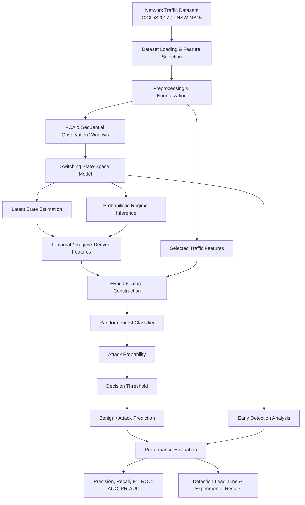

<div align="center">

# PARD-SSM Reproduction & Experimental Evaluation

### Probabilistic Attack Regime Detection in Network Traffic Using Switching State-Space Models


**An independent reproduction and experimental extension of PARD-SSM, evaluating probabilistic attack-regime detection on CICIDS2017 and UNSW-NB15.**

</div>

---

## 1. Overview

PARD-SSM models network traffic as a latent dynamical system. Instead of treating every network flow as an isolated classification problem, a Switching State-Space Model (SSSM) estimates hidden system states and changing attack regimes from sequential observations.

This repository contains an independent reproduction and evaluation workflow based on the original PARD-SSM research. It retains the original implementation and adds experiments for baseline comparison, component ablation, and statistical evaluation.

**Note:** This is a reproduction and experimental extension, not a claim of exact reproduction of every result or preprocessing decision in the original paper.

## 2. Research Objectives

* Model changing network behaviour using probabilistic switching state-space dynamics.
* Evaluate attack detection on CICIDS2017 and UNSW-NB15.
* Compare the hybrid Switching SSM approach against conventional baselines.
* Measure classification performance and detection lead time.
* Study individual component contributions through ablation experiments.

## 3. Methodology

The experimental pipeline follows this general workflow:

```text
Network Traffic Datasets
          |
          v
Dataset Loading & Feature Selection
          |
          v
Preprocessing & Normalization
          |
          v
PCA & Sequential Observation Windows
          |
          v
Switching State-Space Model
          |
          v
Probabilistic Regime Inference
          |
          v
Hybrid Random Forest Evaluation
          |
          v
Performance Metrics & Analysis
```

### Mathematical Formulation

The model represents continuous hidden-state dynamics conditioned on a discrete regime:

**State Dynamics**

```text
x_t = A_(s_t) x_(t-1) + w_t
```

**Observation Model**

```text
y_t = C_(s_t) x_t + v_t
```

where:

* `x_t` represents the hidden system state.
* `y_t` represents observed network features.
* `s_t` represents the discrete attack regime.
* `A` represents regime-specific transition dynamics.
* `C` represents the observation matrix.
* `w_t` and `v_t` represent process and observation noise.

Regime transitions are represented through a Markov transition matrix.

## 4. Datasets

| Dataset    | Samples Used | Features | Observed Label Values |
| ---------- | -----------: | -------: | --------------------: |
| CICIDS2017 |       50,000 |       52 |                     5 |
| UNSW-NB15  |       50,000 |       36 |                     2 |

The processed datasets were checked for finite numerical values before experimentation.

The current loader uses random sampling with `random_state=42`.

**Evaluation caveat:** Sampling occurs before the train/test split in the current workflow. Therefore, the resulting 80/20 split should not be interpreted as a strict chronological holdout over the original full dataset.

The UNSW-NB15 processed labels used for these reported experiments are binary. These results should not be interpreted as a validated five-regime UNSW classification experiment.

### Architecture

The system follows a hybrid probabilistic and machine-learning architecture. The Switching State-Space Model (SSSM) captures temporal changes in network behaviour and infers latent attack regimes. A Random Forest (RF) classifier then uses the configured traffic features and regime-derived signals to perform attack detection.

#### System Architecture



#### Core Components

| Component                   | Description                                                                               |
| --------------------------- | ----------------------------------------------------------------------------------------- |
| Dataset Loading             | Loads CICIDS2017 and UNSW-NB15 traffic datasets and selects relevant features.            |
| Preprocessing               | Handles data cleaning, normalization, and feature preparation.                            |
| PCA & Sequential Windows    | Reduces feature dimensionality and prepares sequential observations.                      |
| Switching SSM               | Models hidden system dynamics and changing network attack regimes.                        |
| Regime Inference            | Estimates probabilistic latent regimes from sequential traffic observations.              |
| Hybrid Feature Construction | Combines configured traffic features with signals derived from the SSSM.                  |
| Random Forest               | Performs final binary attack classification.                                              |
| Evaluation                  | Measures detection performance, baseline comparisons, ablations, and detection lead time. |

#### Evaluation Outputs

The architecture supports two complementary evaluation tasks:

1. **Regime Inference:** Evaluates how effectively the Switching SSM identifies latent network behaviour.
2. **Attack Detection:** Evaluates the hybrid SSSM + Random Forest pipeline in distinguishing malicious traffic from benign traffic.

These are separate tasks, so standalone SSSM regime accuracy should not be confused with the hybrid model's attack-detection accuracy.


## 5. Main Experimental Results

The following results are from the held-out 80/20 evaluation on the prepared 50,000-sample datasets.

The hybrid model uses a decision threshold of 0.5.

| Metric              |          CICIDS2017 |           UNSW-NB15 |
| ------------------- | ------------------: | ------------------: |
| Accuracy            |              98.41% |              99.75% |
| Attack Precision    |              93.95% |              90.13% |
| Attack Recall       |              98.28% |              99.06% |
| F1-Score            |              0.9607 |              0.9438 |
| ROC-AUC             |              0.9981 |              0.9996 |
| PR-AUC              |              0.9937 |              0.9823 |
| Detection Lead Time | 28.32 ± 14.26 steps | 31.24 ± 13.52 steps |

### Standalone Switching SSM

| Dataset    | Regime Classification Accuracy |
| ---------- | -----------------------------: |
| CICIDS2017 |                         79.81% |
| UNSW-NB15  |                         95.23% |

These standalone results are different from the hybrid attack-detection metrics above.

## 6. Baseline Comparison

The following results correspond to the current baseline experiment configuration, including 10-epoch LSTM runs.

### CICIDS2017

| Method                 |  Precision |     Recall |   F1-Score |    ROC-AUC |     PR-AUC |
| ---------------------- | ---------: | ---------: | ---------: | ---------: | ---------: |
| HMM                    |     0.1780 |     0.0451 |     0.0719 |     0.4947 |     0.1946 |
| Isolation Forest       |     0.7444 |     0.3170 |     0.4446 |     0.7041 |     0.4786 |
| LSTM                   |     0.1977 |     0.9504 |     0.3273 |     0.5058 |     0.2010 |
| **Switching SSM + RF** | **0.9390** | **0.9828** | **0.9604** | **0.9982** | **0.9936** |


### UNSW-NB15

| Method                 |  Precision |     Recall |   F1-Score |    ROC-AUC |     PR-AUC |
| ---------------------- | ---------: | ---------: | ---------: | ---------: | ---------: |
| HMM                    |     0.0190 |     0.0896 |     0.0314 |     0.5008 |     0.0210 |
| Isolation Forest       |     0.2756 |     0.3302 |     0.3004 |     0.9723 |     0.2775 |
| LSTM                   |     0.0214 |     0.5425 |     0.0413 |     0.4975 |     0.0208 |
| **Switching SSM + RF** | **0.9013** | **0.9906** | **0.9438** | **0.9996** | **0.9826** |


**Observation:** The hybrid Switching SSM approach achieved the strongest overall F1-score and attack recall among the evaluated baselines in these experiments.

**Baseline caveats:** The UNSW-NB15 HMM run produced a likelihood non-convergence warning. LSTM performance is specific to the current 10-epoch configuration and should not be treated as a universal benchmark.

## 7. Ablation Study

The ablation experiments investigate the contribution of the Switching SSM and difference components.

### CICIDS2017

| Configuration              |     Recall |   F1-Score |    ROC-AUC |     PR-AUC |       Lead Time |
| -------------------------- | ---------: | ---------: | ---------: | ---------: | --------------: |
| RF Only                    |     0.9853 |     0.9570 |     0.9979 |     0.9917 |             0.0 |
| RF + Difference            |     0.9828 |     0.9604 |     0.9981 |     0.9935 |             0.0 |
| RF + SSSM                  |     0.9808 |     0.9613 |     0.9983 |     0.9940 |     27.7 ± 14.7 |
| **RF + Difference + SSSM** | **0.9828** | **0.9607** | **0.9981** | **0.9935** | **27.7 ± 14.7** |


### UNSW-NB15

| Configuration              |     Recall |   F1-Score |    ROC-AUC |     PR-AUC |       Lead Time |
| -------------------------- | ---------: | ---------: | ---------: | ---------: | --------------: |
| RF Only                    |     0.9764 |     0.9409 |     0.9997 |     0.9809 |             0.0 |
| RF + Difference            |     0.9764 |     0.9388 |     0.9996 |     0.9817 |             0.0 |
| RF + SSSM                  |     0.9858 |     0.9457 |     0.9997 |     0.9877 |     31.0 ± 13.7 |
| **RF + Difference + SSSM** | **0.9906** | **0.9438** | **0.9996** | **0.9826** | **31.0 ± 13.7** |


### Key Findings

* The Switching SSM component contributes measurable early-detection lead time.
* On UNSW-NB15, adding the SSSM improves recall and F1-score over the RF-only configuration.
* On CICIDS2017, RF-only achieves slightly higher recall, while SSSM-based configurations provide earlier detection.
* The contribution of SSSM varies across datasets and metrics; it does not improve every classification metric in every experiment.

## 8. Repository Structure

```text
PARD-Original/
│
├── docs/
│   ├── dataset_guide.md
│   ├── math_derivations.md
│   └── regime_detection.gif
│
├── experiments/
│   ├── ablation_study.py
│   ├── baselines.py
│   ├── statistical_significance.py
│   ├── evaluation_metrics.py
│   ├── run_baseline.py
│   └── run_switching.py
│
├── results/
│   ├── Figure_1.png
│   ├── Figure_2.png
│   ├── Figure_3.png
│   ├── Figure_4.png
│   ├── Figure_5.png
│   ├── Figure_6.png
│   ├── ablation_cicids2017.png
│   ├── ablation_unswnb15.png
│   ├── baselines_cicids2017.png
│   ├── baselines_unswnb15.png
│   └── significance results
│
├── src/
│   ├── data_processing/
│   ├── explainablity/
│   ├── inference/
│   ├── models/
│   └── utils/
│
├── tests/
├── requirements.txt
├── LICENSE
└── README.md
```

Raw datasets, processed arrays, temporary outputs, and model checkpoints are excluded from Git.

## 9. Installation

### Clone the repository

```powershell
git clone https://github.com/PeerAhammad/PARD-SSM-Probabilistic-Attack-Regime-Detection-using-Switching-State-Space-Models.git

cd PARD-SSM-Probabilistic-Attack-Regime-Detection-using-Switching-State-Space-Models
```

### Create a virtual environment

```powershell
python -m venv .venv

.venv\Scripts\Activate.ps1
```

### Install dependencies

```powershell
python -m pip install --upgrade pip

pip install -r requirements.txt
```

## 10. Running Experiments

### Prepare datasets

Place the downloaded datasets in the expected `data/raw/` directories and generate the processed arrays using the workflow documented in:

`docs/dataset_guide.md`

The following processed files are expected:

```text
data/processed/cicids2017_features.npy
data/processed/cicids2017_labels.npy

data/processed/unswnb15_features.npy
data/processed/unswnb15_labels.npy
```

### Run the main Switching SSM experiments

```powershell
python -m src.models.switching_ssm --data data/processed/cicids2017_features.npy --labels data/processed/cicids2017_labels.npy --dataset-name CICIDS2017 --no-shap
```

```powershell
python -m src.models.switching_ssm --data data/processed/unswnb15_features.npy --labels data/processed/unswnb15_labels.npy --dataset-name UNSW-NB15 --no-shap
```

### Run baseline experiments

```powershell
python experiments/baselines.py --dataset cicids2017 --lstm-epochs 10

python experiments/baselines.py --dataset unswnb15 --lstm-epochs 10
```

### Run ablation experiments

```powershell
python experiments/ablation_study.py --dataset cicids2017

python experiments/ablation_study.py --dataset unswnb15
```

### Run statistical significance experiments

```powershell
python experiments/statistical_significance.py --help
```

Use the available command-line options to select the dataset and experiment configuration.

### Run tests

```powershell
python -m pytest -q
```

## 11. Limitations

* Results are based on the current 50,000-sample processed datasets and experiment configurations.
* Random sampling before splitting means the current evaluation is not a strict chronological holdout from the original traffic timeline.
* The processed UNSW-NB15 labels used in these experiments are binary.
* The UNSW-NB15 HMM baseline produced a non-convergence warning.
* LSTM performance depends on training duration, preprocessing, threshold, and split configuration.
* Detection lead time is measured in sequence steps, not seconds.
* High benchmark performance does not establish production readiness.
* Further evaluation on independent chronological traffic and live network streams is required.

## 12. Original Research and Attribution

This repository is derived from and builds upon the original PARD-SSM research.

**Original research resources:**

* Research preprint: [arXiv:2604.02299](https://arxiv.org/abs/2604.02299)
* Original project DOI: [10.5281/zenodo.19697928](https://doi.org/10.5281/zenodo.19697928)

The original research and its authors retain their respective attribution. The additional experiment scripts, evaluation runs, plots, and reproduction documentation in this repository constitute separate reproduction and experimental contributions.


## 13. License

This repository retains the original **Apache License 2.0**.

See [`LICENSE`](LICENSE) for the complete license terms. Preserve the original license and applicable attribution notices when redistributing this derivative work.

---

<div align="center">

**Independent Reproduction & Experimental Evaluation**

*Exploring probabilistic approaches to early cyber-attack detection.*

</div>
