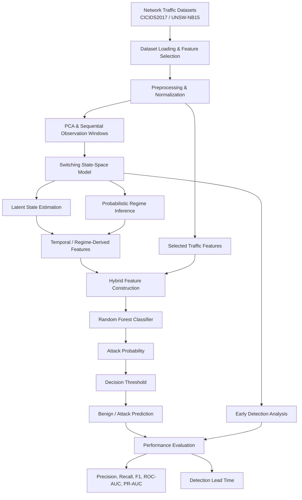
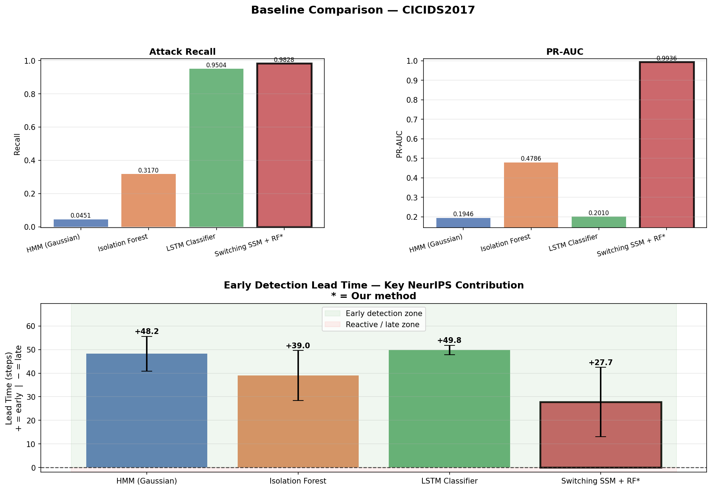
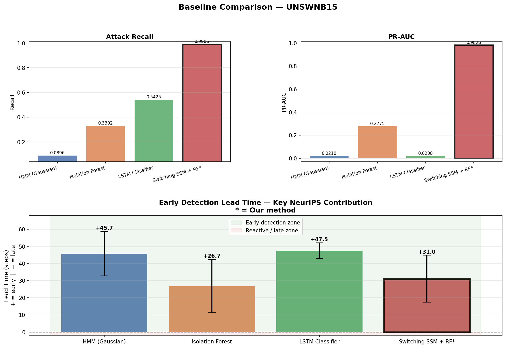
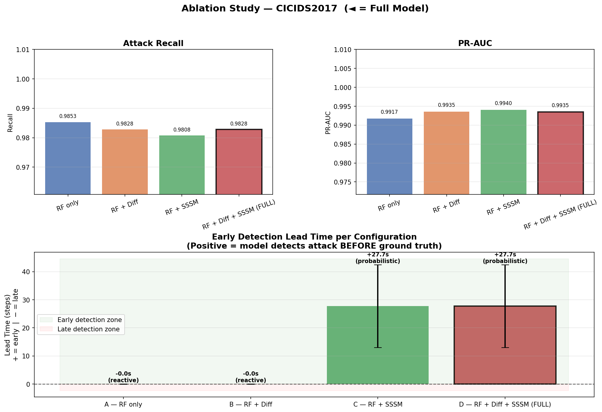
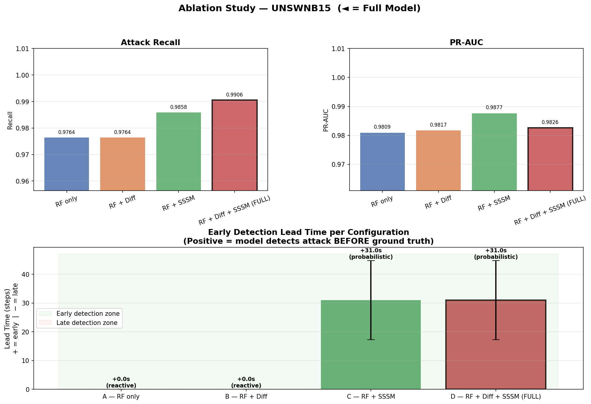

<div align="center">

# PARD-SSM: Reproduction & Experimental Evaluation

**Probabilistic Attack Regime Detection in Network Traffic Using Switching State-Space Models**


[](https://arxiv.org/abs/2604.02299)
[](https://doi.org/10.5281/zenodo.19697928)

An independent reproduction and experimental extension of PARD-SSM, evaluating probabilistic attack-regime detection on **CICIDS2017** and **UNSW-NB15**.

</div>

---

## Highlights

| | CICIDS2017 | UNSW-NB15 |
| :-- | --: | --: |
| Hybrid SSSM + RF, F1 | 0.9607 | 0.9438 |
| Hybrid SSSM + RF, ROC-AUC | 0.9981 | 0.9996 |
| Detection lead time (steps) | 28.32 ± 14.26 | 31.24 ± 13.52 |
| Best baseline F1 (Isolation Forest) | 0.4446 | 0.3004 |

- The SSSM is the only configuration in the ablation that provides early-detection lead time.
- It does not improve every classification metric on every dataset (see [Section 7](#7-ablation-study)).
- Evaluation uses a random 80/20 split of 50,000-sample subsets, not a chronological holdout (see [Section 4](#4-datasets)).

## Quick Start

```powershell
git clone https://github.com/PeerAhammad/PARD-SSM-Probabilistic-Attack-Regime-Detection-using-Switching-State-Space-Models.git
cd PARD-SSM-Probabilistic-Attack-Regime-Detection-using-Switching-State-Space-Models
python -m venv .venv; .venv\Scripts\Activate.ps1
pip install -r requirements.txt
```

Then prepare the datasets ([`docs/dataset_guide.md`](docs/dataset_guide.md)) and run:

```powershell
python -m src.models.switching_ssm --data data/processed/cicids2017_features.npy --labels data/processed/cicids2017_labels.npy --dataset-name CICIDS2017 --no-shap
```

See [Section 10](#10-running-experiments) for all experiments.

---

## Table of Contents

1. [Overview](#1-overview)
2. [Research Objectives](#2-research-objectives)
3. [Methodology](#3-methodology)
4. [Datasets](#4-datasets)
5. [Main Results](#5-main-results)
6. [Baseline Comparison](#6-baseline-comparison)
7. [Ablation Study](#7-ablation-study)
8. [Repository Structure](#8-repository-structure)
9. [Installation](#9-installation)
10. [Running Experiments](#10-running-experiments)
11. [Limitations](#11-limitations)
12. [Attribution](#12-attribution)
13. [License](#13-license)

---

## 1. Overview

PARD-SSM models network traffic as a latent dynamical system. Rather than classifying each flow in isolation, a **Switching State-Space Model (SSSM)** infers hidden system states and changing attack regimes from sequences of observations.

This repository retains the original implementation and adds:

- baseline comparisons (HMM, Isolation Forest, LSTM),
- component ablation experiments,
- statistical significance evaluation.

> **Scope note:** This is a reproduction and experimental extension. It does not claim exact replication of every result or preprocessing decision in the original paper.

## 2. Research Objectives

- Model changing network behaviour with probabilistic switching state-space dynamics.
- Evaluate attack detection on CICIDS2017 and UNSW-NB15.
- Compare the hybrid SSSM + Random Forest approach against conventional baselines.
- Measure classification performance and detection lead time.
- Quantify individual component contributions through ablation.

## 3. Methodology

### 3.1 Mathematical Formulation

Continuous hidden-state dynamics are conditioned on a discrete regime $s_t$:

$$
x_t = A_{s_t}\, x_{t-1} + w_t \qquad \text{(state dynamics)}
$$

$$
y_t = C_{s_t}\, x_t + v_t \qquad \text{(observation model)}
$$

| Symbol | Meaning |
| :----- | :------ |
| $x_t$ | Hidden system state |
| $y_t$ | Observed network features |
| $s_t$ | Discrete attack regime |
| $A_{s_t}$ | Regime-specific transition dynamics |
| $C_{s_t}$ | Observation matrix |
| $w_t,\ v_t$ | Process and observation noise |

Regime transitions follow a Markov transition matrix.

### 3.2 Architecture

The system is a hybrid probabilistic and machine-learning pipeline. The SSSM captures temporal changes in network behaviour and infers latent attack regimes. A Random Forest (RF) then combines the configured traffic features with regime-derived signals to perform attack detection.



### 3.3 Core Components

| Component | Description |
| :-------- | :---------- |
| Dataset Loading | Loads CICIDS2017 and UNSW-NB15 traffic data and selects relevant features. |
| Preprocessing | Data cleaning, normalization, and feature preparation. |
| PCA & Sequential Windows | Dimensionality reduction and construction of sequential observations. |
| Switching SSM | Models hidden dynamics and changing attack regimes. |
| Regime Inference | Estimates probabilistic latent regimes from sequential observations. |
| Hybrid Feature Construction | Combines traffic features with SSSM-derived signals. |
| Random Forest | Final binary attack classification. |
| Evaluation | Detection metrics, baselines, ablations, and lead time. |

### 3.4 Evaluation Tasks

The architecture supports two distinct tasks:

1. **Regime inference:** how well the SSSM identifies latent network behaviour.
2. **Attack detection:** how well the hybrid SSSM + RF pipeline separates malicious from benign traffic.

These are separate tasks; standalone SSSM regime accuracy must not be confused with hybrid attack-detection accuracy.

## 4. Datasets

| Dataset | Samples Used | Features | Label Values Observed |
| :------ | -----------: | -------: | --------------------: |
| CICIDS2017 | 50,000 | 52 | 5 |
| UNSW-NB15 | 50,000 | 36 | 2 |

Processed datasets were verified to contain only finite numerical values before experimentation. The loader uses random sampling with `random_state=42`.

> **Evaluation caveat:** Sampling occurs *before* the train/test split. The resulting 80/20 split is therefore not a strict chronological holdout over the original full dataset.

> **Label caveat:** The processed UNSW-NB15 labels used here are binary. These results do not constitute a validated five-regime UNSW-NB15 classification experiment.

## 5. Main Results

Results are from the held-out 80/20 evaluation on the prepared 50,000-sample datasets, using a decision threshold of 0.5.

| Metric | CICIDS2017 | UNSW-NB15 |
| :----- | ---------: | --------: |
| Accuracy | 98.41% | 99.75% |
| Attack Precision | 93.95% | 90.13% |
| Attack Recall | 98.28% | 99.06% |
| F1-Score | 0.9607 | 0.9438 |
| ROC-AUC | 0.9981 | 0.9996 |
| PR-AUC | 0.9937 | 0.9823 |
| Detection Lead Time (steps) | 28.32 ± 14.26 | 31.24 ± 13.52 |

**Standalone Switching SSM (regime classification)**

| Dataset | Regime Classification Accuracy |
| :------ | -----------------------------: |
| CICIDS2017 | 79.81% |
| UNSW-NB15 | 95.23% |

These measure regime inference, not attack detection, and are not comparable to the metrics above.

## 6. Baseline Comparison

Results use the current baseline configuration, including 10-epoch LSTM training. Best value per column is in **bold**.

### 6.1 CICIDS2017

| Method | Precision | Recall | F1-Score | ROC-AUC | PR-AUC |
| :----- | --------: | -----: | -------: | ------: | -----: |
| HMM | 0.1780 | 0.0451 | 0.0719 | 0.4947 | 0.1946 |
| Isolation Forest | 0.7444 | 0.3170 | 0.4446 | 0.7041 | 0.4786 |
| LSTM | 0.1977 | 0.9504 | 0.3273 | 0.5058 | 0.2010 |
| **Switching SSM + RF** | **0.9390** | **0.9828** | **0.9604** | **0.9982** | **0.9936** |

<p align="center">
  
</p>

### 6.2 UNSW-NB15

| Method | Precision | Recall | F1-Score | ROC-AUC | PR-AUC |
| :----- | --------: | -----: | -------: | ------: | -----: |
| HMM | 0.0190 | 0.0896 | 0.0314 | 0.5008 | 0.0210 |
| Isolation Forest | 0.2756 | 0.3302 | 0.3004 | 0.9723 | 0.2775 |
| LSTM | 0.0214 | 0.5425 | 0.0413 | 0.4975 | 0.0208 |
| **Switching SSM + RF** | **0.9013** | **0.9906** | **0.9438** | **0.9996** | **0.9826** |

<p align="center">
  
</p>

**Observation:** The hybrid SSSM + RF model achieved the highest F1-score and attack recall among the evaluated methods in these experiments.

**Caveats**

- The UNSW-NB15 HMM run produced a likelihood non-convergence warning.
- LSTM results are specific to the 10-epoch configuration, not a general benchmark.
- Values here and in Section 7 come from separate script runs, so they may differ slightly from Section 5.

## 7. Ablation Study

The ablation isolates the contribution of the Switching SSM and the difference features. Lead time is reported in sequence steps.

### 7.1 CICIDS2017

| Configuration | Recall | F1-Score | ROC-AUC | PR-AUC | Lead Time |
| :------------ | -----: | -------: | ------: | -----: | --------: |
| RF Only | 0.9853 | 0.9570 | 0.9979 | 0.9917 | 0.0 |
| RF + Difference | 0.9828 | 0.9604 | 0.9981 | 0.9935 | 0.0 |
| RF + SSSM | 0.9808 | 0.9613 | 0.9983 | 0.9940 | 27.7 ± 14.7 |
| **RF + Difference + SSSM** (full) | 0.9828 | 0.9607 | 0.9981 | 0.9935 | 27.7 ± 14.7 |

<p align="center">
  
</p>

### 7.2 UNSW-NB15

| Configuration | Recall | F1-Score | ROC-AUC | PR-AUC | Lead Time |
| :------------ | -----: | -------: | ------: | -----: | --------: |
| RF Only | 0.9764 | 0.9409 | 0.9997 | 0.9809 | 0.0 |
| RF + Difference | 0.9764 | 0.9388 | 0.9996 | 0.9817 | 0.0 |
| RF + SSSM | 0.9858 | 0.9457 | 0.9997 | 0.9877 | 31.0 ± 13.7 |
| **RF + Difference + SSSM** (full) | 0.9906 | 0.9438 | 0.9996 | 0.9826 | 31.0 ± 13.7 |

<p align="center">
  
</p>

### 7.3 Key Findings

- The SSSM is the only component that yields non-zero detection lead time.
- On UNSW-NB15, adding the SSSM improves recall and F1 over RF-only.
- On CICIDS2017, RF-only has slightly higher recall, while SSSM-based configurations detect attacks earlier.
- The SSSM's contribution varies by dataset and metric; it does not improve every classification metric in every experiment.

## 8. Repository Structure

```text
PARD-Original/
├── docs/
│   ├── dataset_guide.md
│   ├── math_derivations.md
│   └── regime_detection.gif
├── experiments/
│   ├── ablation_study.py
│   ├── baselines.py
│   ├── evaluation_metrics.py
│   ├── run_baseline.py
│   ├── run_switching.py
│   └── statistical_significance.py
├── results/
│   ├── Figure_1.png ... Figure_6.png
│   ├── ablation_cicids2017.png
│   ├── ablation_unswnb15.png
│   ├── baselines_cicids2017.png
│   ├── baselines_unswnb15.png
│   └── significance results
├── src/
│   ├── data_processing/
│   ├── explainablity/
│   ├── inference/
│   ├── models/
│   └── utils/
├── tests/
├── requirements.txt
├── LICENSE
└── README.md
```

Raw datasets, processed arrays, temporary outputs, and model checkpoints are excluded from Git.

## 9. Installation

**1. Clone the repository**

```powershell
git clone https://github.com/PeerAhammad/PARD-SSM-Probabilistic-Attack-Regime-Detection-using-Switching-State-Space-Models.git
cd PARD-SSM-Probabilistic-Attack-Regime-Detection-using-Switching-State-Space-Models
```

**2. Create a virtual environment**

```powershell
python -m venv .venv
.venv\Scripts\Activate.ps1
```

**3. Install dependencies**

```powershell
python -m pip install --upgrade pip
pip install -r requirements.txt
```

## 10. Running Experiments

### 10.1 Prepare datasets

Download the datasets into the expected `data/raw/` directories and generate processed arrays following [`docs/dataset_guide.md`](docs/dataset_guide.md). The following files are expected:

```text
data/processed/cicids2017_features.npy
data/processed/cicids2017_labels.npy
data/processed/unswnb15_features.npy
data/processed/unswnb15_labels.npy
```

### 10.2 Main Switching SSM experiments

```powershell
python -m src.models.switching_ssm --data data/processed/cicids2017_features.npy --labels data/processed/cicids2017_labels.npy --dataset-name CICIDS2017 --no-shap

python -m src.models.switching_ssm --data data/processed/unswnb15_features.npy --labels data/processed/unswnb15_labels.npy --dataset-name UNSW-NB15 --no-shap
```

### 10.3 Baselines

```powershell
python experiments/baselines.py --dataset cicids2017 --lstm-epochs 10
python experiments/baselines.py --dataset unswnb15 --lstm-epochs 10
```

### 10.4 Ablations

```powershell
python experiments/ablation_study.py --dataset cicids2017
python experiments/ablation_study.py --dataset unswnb15
```

### 10.5 Statistical significance

```powershell
python experiments/statistical_significance.py --help
```

Use the available options to select the dataset and experiment configuration.

### 10.6 Tests

```powershell
python -m pytest -q
```

## 11. Limitations

- **Data:** 50,000-sample subsets, randomly sampled before the split, so no chronological holdout; UNSW-NB15 labels are binary ([Section 4](#4-datasets)).
- **Baselines:** The UNSW-NB15 HMM did not converge, and LSTM results depend on the 10-epoch configuration ([Section 6](#6-baseline-comparison)).
- **Metrics:** Detection lead time is in sequence steps, not seconds.
- **Deployment:** Strong benchmark results do not establish production readiness. Independent chronological traffic and live network streams are still needed.

## 12. Attribution

This repository is derived from and builds on the original PARD-SSM research.

- **Preprint:** [arXiv:2604.02299](https://arxiv.org/abs/2604.02299)
- **Original project DOI:** [10.5281/zenodo.19697928](https://doi.org/10.5281/zenodo.19697928)

The original research and its authors retain their respective attribution. The additional experiment scripts, evaluation runs, plots, and reproduction documentation in this repository are separate reproduction and experimental contributions.

## 13. License

Released under the original **Apache License 2.0**. See [`LICENSE`](LICENSE) for the full terms, and preserve the license and attribution notices when redistributing this derivative work.

---

<div align="center">

*Independent reproduction and experimental evaluation of probabilistic early cyber-attack detection.*

</div>
